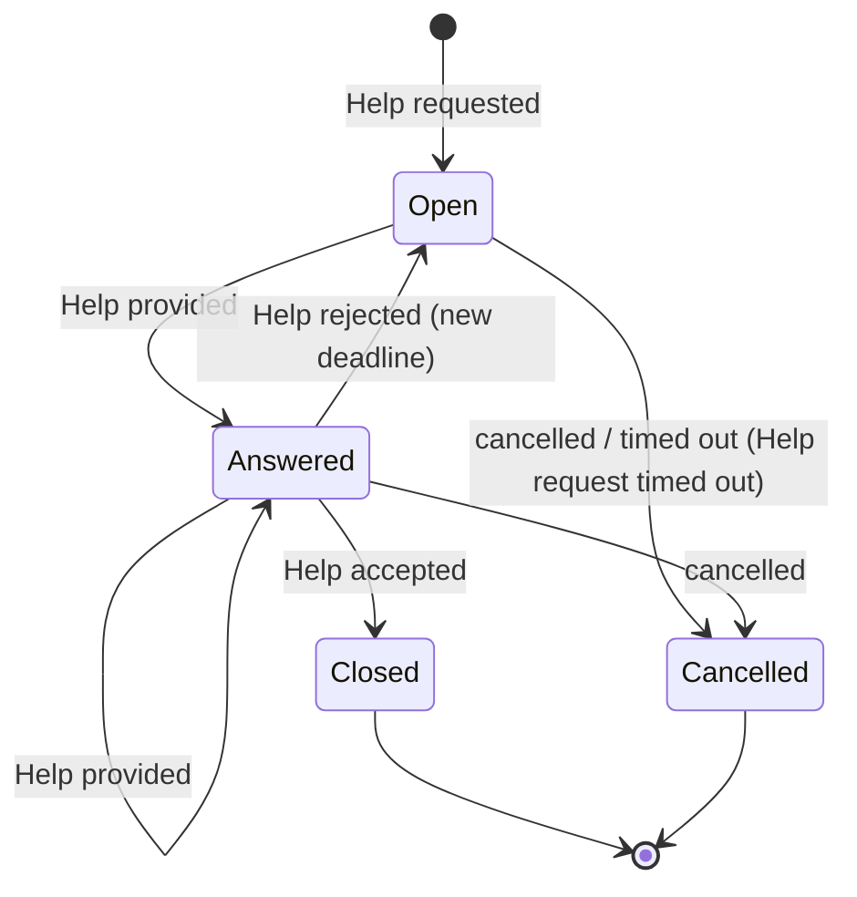

# Detail Design Brief — Cook Assistance (merged context brief, keyed by slice ID)

Step 2 of the implementation blueprint.

**Sources:**
- Boards B1–B4: see `boards-slices.md` for legend, transcription and slice tables.
- Graph models: Help Request v1/v2 (`Art_Glossary_HelpRequest`, `_v2`), Help (`Art_Glossary_Help`), Example Maps US-CA-01…04.
- Decisions SADR0001 and SADR0004.

**Labels:** *on board* = sticky on a B1–B4 board · *model* = Help Request / Help glossary model · *map* = Example Map rule · *inferred* = derived here, to be confirmed.

The four per-board briefs are identical in structure and differ only in the variant rows. They are therefore merged here. Variant rows are marked with their board.

## 1. Aggregates

### Help Request (aggregate root — on board as business object "Help request <type>"; model; SADR0004)

**Minimal state the invariants need:**

| Element | Source | Detail |
|---|---|---|
| helpRequestId | model | |
| requester (cook Id) | model | |
| type | model | Menu proposal (B1) · Ingredient Substitute (B2) · Preparation Step Explanation (B3) · Steps to Mitigate Catastrophe (B4) |
| status | model v2 | Open · Answered · Closed |
| preferred Provider(s) | model | Chef · Community · Grandma Avatar |
| recipe | model / map | mandatory for B2 and B3; optional for B4 ("can be provided not mandatory", on board); B1 ⟨open⟩ |
| howTo Step | model | B3 only: one numbered step of one recipe (map US-CA-03 R2) |
| ingredients | model | B2 only: one ingredient plus substitute requirements (map US-CA-02 R2 vs model "ingredients" 0..* → contradiction `R_EM02_R2`) |
| title, description, pictures | model / map | pictures 0..* (model v2) vs 0..10 (glossary v2); text only for B3 (map R3); photos allowed for B4 (map R3) |
| deadline | map, inferred as state | per type: B3 12 h · B2 24 h · B4 15 min Community / 5 min Grandma · B1 48 h or 24 h before the Occasion |
| notes | map | rejection notes, kept and shown on future requests (B3 R6, B4 R7); rejected substitutes not proposed again (B2 R5) |
| Occasion | map, B1 only | US-CA-01 R1 |

### Help (**entity inside Help Request** — decision D1; the model and SADR0004 call it an aggregate root; on board as business object "Help <type>")

**State:**
- help Id
- help request ref
- help requester
- help provider type: Chef / Grandma Avatar / Community
- help provider 0..1
- answer title
- answer, with answerType and oneOf: substitutes / preparation step explanation / catastrophe mitigation / menu proposal
- images
- isAccepted

**Invariants (model):**
- answerType = the request's type
- same recipe / howTo / ingredientId as in the request
- a cook can answer their own request, except for Chef requests

**Boundary finding, resolved by D1 (Help is an entity in Help Request):** every invariant of Help reads Help Request state:
- type, recipe, step, ingredient
- preferred providers and Chef exclusivity
- requester
- status (Cancelled or Closed requests take no Help)

"Accept help" changes both aggregates: Help.isAccepted, and Help Request → Closed. That spans two aggregates.

## 2. Command handlers (by slice)

| Slice | Command → aggregate | Preconditions / invariants | Success event | Rejections (inferred names) |
|---|---|---|---|---|
| B3-S01 | Request help Preparation step → Help Request | every Cook can ask (map R1) · providers ⊆ {Community, Grandma Avatar}, never Chef (on board; map R1) · recipe mandatory (model) · exactly one howTo step of one recipe (map R2) · text only (map R3) · status := Open, deadline := now + 12 h (map R8) | Help requested | Chef not allowed · step missing · pictures not allowed |
| B2-S01 | Request help ingredients → Help Request | as B3-S01, plus: one ingredient with substitute requirements (map R2) · recipe mandatory (model) · deadline 24 h | Help requested | |
| B4-S01 | Request help Catastrophe → Help Request | providers Community / Grandma · one catastrophe, one dish, recipe optional (map R2; on board) · photos allowed (map R3) · deadline 15 min / 5 min | Help requested | |
| B1-S01 | Request help meal plan → Help Request | premium Cook only (on board ×2; map R3) · Chef selected by name (on board; map R4) · Chef can answer in time, in their time zone (map R5) · one Occasion (map R1) · ≥ 48 h before the Occasion (map R9) · Chef exclusive (SADR0001; model) · several open requests allowed (map R4) | Help requested | not premium · Chef not selected · Chef unavailable · Occasion too close |
| B*-S02 | Provide Help → Help Request (adds a Help entity; D1) | request is Open or Answered (model v2: answered can still be answered) · provider in the request's providers · a Cook never answers their own request (on board; D3) · answerType = request type · same recipe / step / ingredient · B1: Chef only and exclusive (D2), a Chef may review a Grandma Menu (on board; map R6) · B2: several substitutes (map R3) · B3: may include pictures (map R4) | Help provided; Help Request → Answered | request closed or cancelled · wrong provider · type mismatch |
| B3-S03 | Cancel help request → Help Request | only the requester (inferred; `Q_ESD_CancelActor`) · request Open or Answered · optional note (map US-CA-03 R7) · at any time while Open or Answered (map US-CA-03 R7; D4) | Help request cancelled | not requester · already closed or cancelled |
| B3-S04 | Accept help → Help Request (sets Help.isAccepted; one transaction, D1) *added* | requester only · Help belongs to the request · request Answered · accepting closes the whole request (maps 02 R3, 03 R4, 04 R5) · "at least one Help must be accepted" (model v2) | Help accepted → status Closed | not answered · foreign help |
| B3-S05 | Reject help → Help Request *added* | requester only · a note on what didn't work · resent to the same providers · new deadline (12 h / 24 h / per type) · rejected substitutes kept (B2 R5) · B1: reset gives 48 h (map R8) | Help rejected → status Open | |
| B3-S06 | Time out help request → Help Request *added, automation* | trigger: clock at the deadline, if no Help accepted ("System cancels request when answer takes too long", on board) · suggest a provider not yet asked (maps 02 R7, 03 R8, 04 R9) | Help request timed out → status Cancelled (D5) | — |

## 3. Lifecycle — Help Request (one state machine for all four boards)

States:
- Open, Answered, Closed (model v2)
- **Cancelled** (added by decision; from the board event "Help request cancelled"; answers `Q_ESD_CancelledStatus`)

| From | Command | Event | To |
|---|---|---|---|
| — | Request help <type> | Help requested | Open |
| Open | Provide Help | Help provided | Answered |
| Answered | Provide Help | Help provided | Answered (model v2: "can still be answered") |
| Answered | Accept help | Help accepted | **Closed** (terminal) |
| Answered | Reject help | Help rejected | Open, with a new deadline (inferred: "the request stays open", map 02 R4) |
| Open / Answered | Cancel help request | Help request cancelled | **Cancelled** (terminal) |
| Open | Time out help request (clock) | Help request timed out | **Cancelled** (terminal) |

Illegal in Closed and Cancelled: every command.

## 4. Policies and integration (cross-context)

| Policy | Reacts to | Does | Classification | Read model / evidence |
|---|---|---|---|---|
| Notify | Help requested (published as HelpRequestCreated) | Notification: "Cook notified" | cross-context (on board) | US-CA-04 R4: Community notified of every request sent to it |
| Grandma Avatar | consumes the request | publishes HelpProvided; Cook Assistance consumes it → Provide Help | cross-context (AsyncAPI; ADR0003) | — |
| Timeout | clock reaches the deadline | Time out help request | time-triggered automation | deadline in Help Request |

Hotspot "Define timeouts" — answered per type by the Example Maps:
- B3: 12 h
- B2: 24 h
- B4: 15 min (Community) / 5 min (Grandma)
- B1: 48 h, or 24 h before the Occasion, whichever is earlier

## 5. Read models

| Read model | Source events | Used by | Fields |
|---|---|---|---|
| Help request <type> (B1–B4; UI "Show help request") | Help requested, Help provided, cancelled, accepted, rejected | Cook; providers | request fields, status, deadline, notes |
| Help <type> (UI "Show help") | Help provided, accepted | Cook | answer, provider, isAccepted |
| Recipe / Recipe Ingredient / Recipe Preparation step | — | requester while composing a request | Recipe Catalog's read models, consumed (upstream) |

## 6. Completeness findings

1. **Command without a resulting event:** "Cook can accept the answer" has no command. Fixed by the added slice B3-S04 (event name ⟨open⟩).
2. **Happy path only:** no rejection events on any board. Rejection names are inferred above.
3. **Event without cause:** "System cancels request" has no trigger sticky. Fixed by B3-S06 (clock).
4. **Rules drawn as lilac stickies:** none are policies, and none use "whenever … then".
5. **Language drift:**
   - "Help requested" (board) vs "Help request created" / `HelpRequestCreated` (graph, AsyncAPI)
   - "Help response" (board v1) vs "Help" (SADR0004)
   - "Help request Ingredients" vs "Help request Ingredient"
   - "Grandma Avartar"
6. **Copy residues:** on B3 and B4 (see `boards-slices.md`).
7. **No Cancelled status in the model,** although the board has the event.

## 7. Contradictions (from the graph) and open questions

| ID | Topic | Board says | Model / map / ADR says |
|---|---|---|---|
| D1 | Help as its own aggregate | — | model + SADR0004: separate aggregate; invariants need Help Request state |
| D2 | Who helps with a Meal plan | B1: "Chef, community, or Grandma" | US-CA-01 R2, SADR0001, model: Chef only and exclusive; map R6: a Chef can review a Grandma Menu |
| D3 | Answering your own request | "Cook cannot answer their own request" (all boards) | Help model: "A cook can answer their own request — except for Chef requests" |
| D4 | When a Cook can cancel | "when answer takes too long" | US-CA-03 R7: "at any time" |
| D5 | Event names for accept, reject and timeout | none on board | ⟨open⟩ |
| D6 | Recipe validation | Recipe Catalog read model consulted | skeleton: validate against Recipe Catalog, or take references as given? |

Other open questions carried from the graph:
- `Q_HRClosedTransition`
- `Q_HelpRequestStateNames`
- `Q_ESD_CancelActor`
- `Q_ESD_CookNotifiedWho`
- `Q_EM01_Q1`, `Q_EM01_Q2`, `Q_EM02_Q1`, `Q_EM03_Q1`, `Q_EM04_Q1` (the Example Maps' red cards — step 3)

## 8. Decisions taken in step 2 (2026-10-31, by the user)

| ID | Decision | Effect |
|---|---|---|
| D1 | **Help is an entity inside the Help Request aggregate** | All Provide Help, Accept and Reject guards are checked in one transaction. The `/helps` API and `HelpProvided` event may stay. Deviates from the glossary and SADR0004 "aggregate root" → logged for an SADR revision in step 5. |
| D2 | **Meal plan (Menu) help: Chef only and exclusive** | B1 sticky "Help Meal plan can be provided by Chef, community, or Grandma" is superseded (US-CA-01 R2, SADR0001). A Chef may review a Grandma Avatar Menu (R6). |
| D3 | **A Cook never answers their own request** | Board rule kept. The Help model invariant "can, except Chef" is superseded. |
| D4 | **A Cook can cancel at any time while Open or Answered** | US-CA-03 R7. The board's "when answer takes too long" is one case of it. |
| D5 | **Events: Help accepted, Help rejected, Help request timed out** | Timeout has its own event. |
| — | **Status Cancelled added** | Open → Answered → Closed, plus Cancelled as a second terminal state. |
| D6 | **Recipe, step and ingredient references taken as given** | Validation against Recipe Catalog (local replica via events per AP0002, or a sync read) is decided in step 5. |

## 9. Effect on the slice plan, skeleton and user stories

- **Slice plan:** all `*-S02` slices (Provide Help) now target the **Help Request** aggregate. B3-S04 and B3-S05 stay single-aggregate. No slice moves board; board order and story order are unchanged.
- **Walking skeleton (B3-S01 + B3-S02):** unchanged and simpler. Provide Help, whether from the broker or from the API, is one aggregate.
- **User stories:** every user story maps to brief rows through its slices.

| User story | Slices | Outcome shown in |
|---|---|---|
| US-CA-03 | B3-S01…S06 | read models Help request / Help Preparation step |
| US-CA-02 | B2-S01, S02, B3-S03…S06 | Help request Ingredient, Help Substitutions |
| US-CA-04 | B4-S01, S02, B3-S03…S06 | Help request / Help Catastrophe; Community notification is Notification's (cross-context) |
| US-CA-01a | B1-S01 | Help request Meal plan |
| US-CA-01b | B1-S02, B3-S04, S05 | Help Meal plan |
| US-CA-01c | B3-S03, S05, S06 | B1 deadlines: 48 h, or 24 h before the Occasion |

- **Still open in this brief:**
  - D6 (step 5)
  - the Example Map red cards (step 3)
  - `Q_ESD_CookNotifiedWho`
  - premium status and Chef availability: they come from other contexts (Cook Profile / Paywall), so how they are obtained is decided in step 5. They block increment 4 only.
